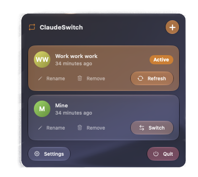

# ClaudeSwitch

A minimalist macOS menu bar app for saving and switching between accounts in the **Claude desktop app** (`Claude.app`, `com.anthropic.claudefordesktop`) -- the Electron-based chat client, not the Claude Code CLI.

<p align="center">
  
</p>

> **Disclaimer:** ClaudeSwitch is an independent, unofficial tool. It is **not affiliated with, endorsed by, or sponsored by Anthropic**. "Claude" and the Claude logo are trademarks of Anthropic; they are referenced here only to identify the app this tool interoperates with (nominative use).

## How it works

Claude desktop stores its login (OAuth tokens + session cookies) under `~/Library/Application Support/Claude/`, encrypted at rest with a per-machine key kept in the login Keychain (`Claude Safe Storage`). ClaudeSwitch never decrypts any of it -- it just:

1. Quits Claude.
2. Copies (or restores) the encrypted identity fragment of `config.json`, the `Cookies` database, and web storage folders into a per-account snapshot.
3. Relaunches Claude.

Because Claude keeps these files open in memory while running, switching **always** quits and relaunches the app -- there's no way to hot-swap accounts in a running Electron app, unlike the Claude Code CLI which re-reads its credentials on every invocation.

Snapshots live under `~/Library/Application Support/ClaudeSwitch/snapshots/<uuid>/`. Account labels are kept in `UserDefaults`; **no tokens are ever stored by ClaudeSwitch itself**. See [`ClaudeSwitch/Services/ProfileStore.swift`](ClaudeSwitch/Services/ProfileStore.swift) and [`ClaudeSwitch/Services/ClaudeDesktopService.swift`](ClaudeSwitch/Services/ClaudeDesktopService.swift) for the implementation.

## Requirements

- **macOS 26** (Tahoe) or later.
- The [Claude desktop app](https://claude.ai/download) installed.

## Install (no Xcode, no Terminal)

1. Go to the [**Releases**](../../releases) page and download **`ClaudeSwitch.zip`** (under the latest release's *Assets*).
2. Double-click the zip to unzip it — you'll get **`ClaudeSwitch.app`**.
3. Drag **`ClaudeSwitch.app`** into your **Applications** folder.
4. **First launch (do this once).** ClaudeSwitch is free and open source but not distributed through the App Store, so macOS asks you to confirm it the first time:
   - **Right-click** (or Ctrl-click) `ClaudeSwitch` in Applications → click **Open** → click **Open** again in the dialog.
   - If macOS still refuses and only offers *Done*: open **System Settings → Privacy & Security**, scroll to the **Security** section, and click **Open Anyway** next to "ClaudeSwitch was blocked", then confirm with Touch ID / password.
   - You only need to do this once; afterwards it launches normally.
5. Look at the **top-right of your menu bar** — ClaudeSwitch runs there (it has no Dock icon and no window).
6. The first time you switch accounts, macOS asks for **Automation** permission (to quit & relaunch Claude). Click **OK**.

> Why the warning? Apps signed with a paid Apple Developer certificate skip it. This one is signed locally to keep it free — the source is right here if you want to inspect or build it yourself.

## Usage

1. **First launch:** ClaudeSwitch will ask for **Automation** permission the first time it needs to quit/relaunch Claude (System Settings > Privacy & Security > Automation). This is required to swap the active session.
2. **Add an account:** sign into Claude with the account you want to save, then click **+** in the menu bar dropdown and give it a label. Claude's own UI handles login; ClaudeSwitch just captures the result.
3. **Switch:** click **Switch** on any saved account. ClaudeSwitch quits Claude, restores that account's snapshot, and relaunches. The active account slides to the top.
4. **Side by Side:** opens a saved account in a second Claude window while the active one keeps running, so you can use two accounts at once (e.g. personal + work). It gets its own data folder under `~/Library/Application Support/ClaudeSwitch/side-by-side/`; **Show** brings it forward and **Close** quits it.
5. **Refresh:** re-captures the currently active account's session so its snapshot doesn't go stale.

## For developers

### Build & run from source

Building yourself skips the Gatekeeper warning entirely. `project.yml` is the only source of truth for the Xcode project (via [XcodeGen](https://github.com/yonaskolb/XcodeGen)); `ClaudeSwitch.xcodeproj` is disposable and git-ignored. You need **Xcode 26+**.

```bash
brew install xcodegen   # once
git clone https://github.com/Baudrim/ClaudeSwitch.git
cd ClaudeSwitch
xcodegen generate
open ClaudeSwitch.xcodeproj
```

Then press **Run** in Xcode.

### Package a shareable build

`scripts/package.sh` builds a Release `.app`, ad-hoc signs it, and zips it into `dist/ClaudeSwitch.zip` — the file to attach to a GitHub Release:

```bash
./scripts/package.sh
# override the toolchain location if needed:
DEVELOPER_DIR=/Applications/Xcode.app/Contents/Developer ./scripts/package.sh
```

For a friction-free install (no Gatekeeper prompt for users), swap the ad-hoc signing step for a Developer ID identity + notarization — see the `NOTARIZE` note inside the script. This requires a paid Apple Developer account.

## Credits & assets

- App icon composed with Xcode's Icon Composer from original artwork (`Icon/ClaudeSwitch.icon/`). The reusable white glyph sources live in `Icon/glyph-kit/`.

## Status

Early prototype. Distributed unsigned/ad-hoc; scope, error handling, and UI polish are expected to evolve.

## License

MIT -- see [`LICENSE`](LICENSE).
